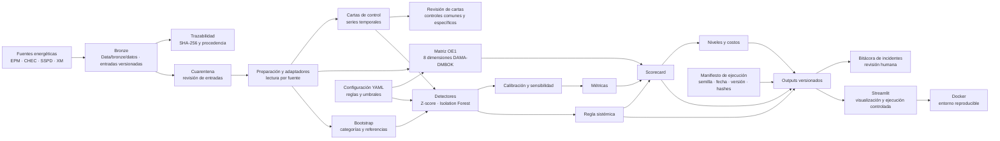

# Diagrama de componentes del artefacto · Hito 5

El siguiente flujo muestra qué recibe cada componente y qué resultado entrega. Las flechas
representan dependencias de proceso; los datos originales no se modifican.

## Lectura del diagrama

1. Los archivos de las fuentes pertenecen a la capa Bronze y se conservan físicamente en `Data/bronze/datos/`; se identifican mediante hashes.
2. La cuarentena separa entradas que requieren revisión antes de analizarlas.
3. Las cartas, la matriz y los detectores producen resultados independientes que después se
   consolidan en el scorecard.
4. La bitácora no se llena automáticamente: una alerta debe revisarse antes de registrarse como
   incidente.
5. Streamlit muestra las salidas y permite ejecutar etapas autorizadas; Docker empaqueta el
   código y el entorno para que otra persona pueda reproducir el tablero.

